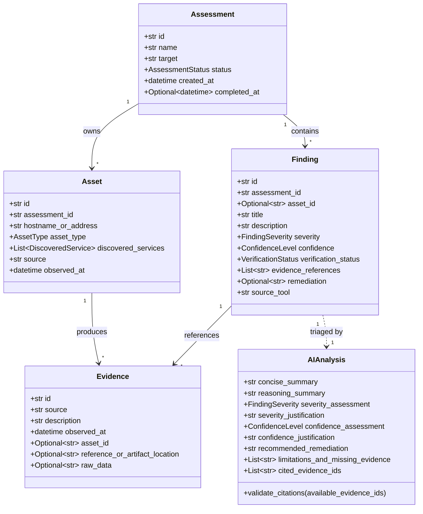

# ZeroTrace

ZeroTrace is a security research and automated triage platform designed to unify reconnaissance, vulnerability assessment, evidence-grounded AI triage, and executive reporting into a single transparent workflow.

The platform ingests findings from external OSINT sources and vulnerability scanners, normalizes them against strict schemas, enforces verification rules so that unbacked claims are not treated as confirmed exploits, provides AI-assisted triage grounded strictly in empirical evidence, and generates auditable security assessment reports.

---

## Table of Contents

- [Overview and Motivation](#overview-and-motivation)
- [Key Features](#key-features)
- [Architecture and Workflow](#architecture-and-workflow)
- [Technology Stack](#technology-stack)
- [Project Directory Structure](#project-directory-structure)
- [Prerequisites](#prerequisites)
- [Installation and Setup Guide](#installation-and-setup-guide)
- [Configuration and Environment Variables](#configuration-and-environment-variables)
- [How to Use the Application](#how-to-use-the-application)
- [API Reference](#api-reference)
- [Data Models and Strict Schema Contracts](#data-models-and-strict-schema-contracts)
- [Testing and Quality Verification](#testing-and-quality-verification)
- [Security, Privacy, and Grounding Guardrails](#security-privacy-and-grounding-guardrails)
- [Known Limitations and Roadmap](#known-limitations-and-roadmap)
- [Troubleshooting and FAQ](#troubleshooting-and-faq)
- [Contributing](#contributing)
- [License](#license)

---

## Overview and Motivation

### What Problem Does ZeroTrace Solve?
Modern penetration tests and vulnerability assessments produce high volumes of disparate data from multiple security tools (network mappers, web application scanners, OSINT crawlers). Security engineers and analysts face three critical bottlenecks:
1. **Tool Output Discrepancies**: Different scanners format asset identifiers, severity levels, and vulnerability descriptions inconsistently.
2. **Hallucination and False Certainty**: Traditional AI triage tools often extrapolate findings beyond the available evidence, invent nonexistent CVEs, or claim a vulnerability is "confirmed" without reproducible proof.
3. **Report Generation Overhead**: Consolidating findings, asset inventories, empirical evidence, and remediation steps into clean, executive-ready reports is manual, error-prone, and slow.

### How Does ZeroTrace Solve This?
- **Strict Shared Contracts**: Every assessment, asset, finding, and piece of evidence must validate against strict Pydantic schemas. Unbacked claims are downgraded from `confirmed` to `unverified`.
- **Evidence-Grounded AI Reasoning**: The AI triage layer analyzes findings using only the provided empirical evidence facts. Any citation of nonexistent evidence is rejected by runtime citation validators.
- **Deterministic Offline Fallbacks**: If external LLM providers or local Ollama instances are unreachable or disabled, a deterministic rule-based analysis engine takes over immediately with zero downtime.
- **Auditable Reporting Engine**: Reports are generated strictly from stored assessment data—no invented counts, no fake percentages, and no fabricated CVEs.

---

## Key Features

### Implemented Features

| Feature | Description | Status |
| :--- | :--- | :---: |
| **Unified Data Contracts** | Pydantic v2 schemas for Assessment, Asset, Evidence, Finding, and AIAnalysis with anti-hallucination citation checks. | Fully Functional |
| **Upstream Normalization Adapter** | Ingests raw outputs from external tools, normalizes schemas, maps severities, and enforces verification clamping. | Fully Functional |
| **Evidence-Grounded AI Analysis** | AI triage engine supporting Ollama (`llama3.2`), OpenAI-compatible endpoints, deterministic fallback, and mock adapters. | Fully Functional |
| **Anti-Hallucination Guardrails** | Citation validator (`validate_citations`) ensuring AI responses cite only valid, supplied evidence IDs. | Fully Functional |
| **Interactive Findings Explorer** | Search across titles, assets, and descriptions with multi-criteria filtering by severity and verification state. | Fully Functional |
| **Detailed Finding Drawer** | Side-by-side inspection separating empirical evidence (verbatim logs, URLs) from AI interpretation. | Fully Functional |
| **One-Click Live AI Triage** | In-app analysis trigger with live loading states, debounce protection, and fallback provenance badges. | Fully Functional |
| **Comprehensive 8-Section Report** | Full assessment dossier with executive summary, asset breakdown, grouped findings, and remediation checklists. | Fully Functional |
| **Multi-Format Report Export** | Instant client-side export to Markdown (`.md`), raw JSON (`.json`), and print-ready PDF styling (`@media print`). | Fully Functional |
| **Subsystem Health Monitor** | Dashboard displaying honest connectivity states for the orchestrator, OSINT engines, and vulnerability scanners. | Fully Functional |
| **Dark Theme Interface** | Restrained charcoal/slate design system built with Vite, React 19, and Tailwind-free vanilla CSS. | Fully Functional |

### Partially Implemented & Planned Features

- **Automated Live Upstream Scanning**: The platform currently provides the normalization adapter (`/api/upstream/normalize`) and health inspection (`/api/upstream/modules`). Active background scan scheduling is handled by upstream agents.
- **Persistent Database Storage**: The active dashboard runs with in-memory test fixtures and stateful client session caches. Integration with persistent relational databases (PostgreSQL/SQLite) is architected via the schemas but currently runs via the API adapter layer.
- **User Role Management**: Single-tenant engineering mode is implemented. Multi-user RBAC is planned.

---

## Architecture and Workflow

ZeroTrace connects the upstream collection tools, backend validation and triage services, and the analyst-facing web dashboard.

```mermaid
flowchart TD
    subgraph Data Sources
        OSINT[OSINT Modules]
        Scanner[Vulnerability Scanners]
    end

    subgraph Backend Core [FastAPI Core - Port 8000]
        Adapter[Upstream Normalizer & Adapter]
        Schemas[Pydantic v2 Shared Contracts]
        AIService[AI Analysis Service]
        FallbackEngine[Deterministic Rule Engine]
        CitationCheck[Evidence Citation Validator]
    end

    subgraph External LLM [Optional AI Providers]
        Ollama[Local Ollama / Llama 3.2]
        OpenAI[OpenAI-Compatible Endpoint]
    end

    subgraph Frontend [React 19 + Vite - Port 5173]
        Overview[Overview & Subsystems]
        Findings[Findings Explorer & Drawer]
        ReportGen[Report Generator & Exporter]
    end

    OSINT -->|Raw JSON| Adapter
    Scanner -->|Raw Results| Adapter
    Adapter -->|Strict Contracts| Schemas
    Schemas --> Backend Core

    Findings -->|POST /api/ai/analyze| AIService
    AIService -->|Consent & Local Check| Ollama
    AIService -->|If Configured| OpenAI
    AIService -->|Fallback on Failure| FallbackEngine
    Ollama --> CitationCheck
    OpenAI --> CitationCheck
    CitationCheck -->|Verified Analysis| Findings

    Findings --> ReportGen
    Overview -->|GET /api/upstream/modules| Adapter
    ReportGen -->|Export| PDF[PDF / Print]
    ReportGen -->|Export| MD[Markdown File]
    ReportGen -->|Export| JSON[JSON File]
```

### Primary Workflow
1. **Ingestion & Normalization**: Raw asset discoveries and scanner outputs pass through `backend/adapter.py`. Findings lacking evidence references are downgraded from `confirmed` to `unverified`.
2. **Interactive Triage**: The analyst explores findings in the web UI at `http://127.0.0.1:5173/findings`.
3. **Evidence-Grounded AI Analysis**: The analyst triggers triage. The backend checks `AI_ALLOW_EXTERNAL_CALLS`. If local or allowed, the configured model is called; otherwise, the deterministic rule engine evaluates the finding.
4. **Citation Validation**: The engine confirms all cited evidence IDs exist. If hallucinated citations are detected, it falls back to the deterministic evaluation.
5. **Dossier Compilation**: The analyst opens the Reports tab, reviews the 8-section audit, and exports to Markdown, JSON, or PDF.

---

## Technology Stack

### Backend
- **Python 3.10+ / 3.12+**
- **FastAPI 0.162.0**: High-performance asynchronous API framework.
- **Uvicorn 0.54.0**: ASGI web server.
- **Pydantic v2 (2.14.1)**: Data parsing, type validation, and contract integrity.
- **HTTPX 0.28.1**: Asynchronous HTTP client for upstream and LLM calls.
- **Pytest 9.1.1**: Test runner.

### Frontend
- **React 19.3.1**: UI library.
- **TypeScript 6.0.3**: Strict static type checking.
- **Vite 8.3.4**: Frontend build tool and development server.
- **Lucide React 1.61.0**: Iconography.
- **Vitest 4.1.4**: Unit and integration test runner.
- **Oxlint 1.88.0**: Fast code linter.
- **Vanilla CSS (`src/index.css`)**: Custom design tokens with no Tailwind dependency.

---

## Project Directory Structure

```text
ZeroTrace/
├── backend/
│   ├── app.py                     # FastAPI application routes, CORS, and health endpoints
│   └── adapter.py                 # Upstream normalizer and integration adapter
├── modules/
│   ├── ai/                        # AI Analysis and reasoning subsystem
│   │   ├── adapter.py             # Model execution engine and Ollama/OpenAI connectors
│   │   ├── analyst.py             # Prompt engineering and structured output parser
│   │   ├── client.py              # LLM client with timeout and network safeguards
│   │   ├── config.py              # AI configuration and environment variable parsing
│   │   ├── planner.py             # Fallback triage rules and heuristics
│   │   └── service.py             # AI analysis facade orchestrating validation
│   └── reporting/                 # Python report generator and exporter
│       ├── generator.py           # 8-section assessment report compiler
│       └── exporter.py            # Markdown, HTML, and JSON file exporter
├── schemas/                       # Shared Pydantic contract definitions
│   ├── contracts.py               # Assessment, Asset, Evidence, Finding, AIAnalysis models
│   ├── enums.py                   # Severity, Confidence, and Verification status enums
│   └── README.md                  # Schema specification and usage documentation
├── frontend/                      # React 19 + TypeScript web application
│   ├── src/
│   │   ├── api/client.ts          # Type-safe API client for backend communication
│   │   ├── components/            # Reusable UI components (Sidebar, TopBar, Drawer, Badges)
│   │   ├── data/mockData.ts       # Baseline sample assessment data for testing
│   │   ├── pages/                 # Overview, Findings, Reports, Assets, Activity pages
│   │   ├── services/              # Client-side report generation and exporter services
│   │   ├── tests/                 # Vitest test suites (UI, AI integration, reports)
│   │   ├── types/                 # TypeScript representations of shared schemas
│   │   └── index.css              # Custom styling, dark mode tokens, and print stylesheets
│   ├── package.json               # Frontend dependencies and npm scripts
│   └── vite.config.ts             # Vite configuration
├── tests/                         # Backend Pytest test suites
│   ├── test_schemas.py            # Schema validation and anti-hallucination tests
│   ├── test_ai_layer.py           # AI adapter, prompt, and fallback tests
│   ├── test_ai_and_reporting.py   # Reporting and AI pipeline integration tests
│   └── test_upstream_integration.py # Normalizer and adapter test suite
├── requirements.txt               # Python package dependencies
└── README.md                      # Project documentation
```

---

## Prerequisites

Before setting up ZeroTrace, ensure the following are installed on your host system:

- **Python**: Version `3.10` or higher (`python --version`)
- **Node.js**: Version `18.0.0` or higher (`node --version`)
- **npm**: Version `9.0.0` or higher (`npm --version`)
- **Git**: Version `2.30.0` or higher (`git --version`)
- *(Optional)* **Ollama**: If running local model inference (`http://localhost:11434`)

Supported Operating Systems:
- Windows 10 / 11 (PowerShell or Command Prompt)
- Linux (Ubuntu 20.04+, Debian, Fedora, Arch)
- macOS (macOS 12 Monterey or higher)

---

## Installation and Setup Guide

### 1. Clone the Repository

```bash
git clone https://github.com/sahil-mss/ZeroTrace.git
cd ZeroTrace
```

### 2. Backend Setup (Python Virtual Environment)

#### On Windows (PowerShell):
```powershell
# Create a virtual environment
python -m venv .venv

# Activate the virtual environment
.venv\Scripts\Activate.ps1

# Upgrade pip and install dependencies
python -m pip install --upgrade pip
pip install -r requirements.txt
pip install -e .

# Run Database Migrations (SQLite)
$env:DATABASE_URL="sqlite:///zerotrace.db"
alembic upgrade head
```

#### On Linux / macOS (Bash / Zsh):
```bash
# Create a virtual environment
python3 -m venv .venv

# Activate the virtual environment
source .venv/bin/activate

# Upgrade pip and install dependencies
pip install --upgrade pip
pip install -r requirements.txt
pip install -e .

# Run Database Migrations (SQLite)
export DATABASE_URL="sqlite:///zerotrace.db"
alembic upgrade head
```

### 3. Frontend Setup (Node.js)

```bash
# Navigate to the frontend directory
cd frontend

# Install dependencies cleanly
npm install

# Return to repository root
cd ..
```

---

## Configuration and Environment Variables

The application runs out of the box using secure default settings (deterministic offline triage engine, local host binding, and open local sandbox mode). To customize behavior, configure the following environment variables:

| Variable | Default Value | Description |
| :--- | :--- | :--- |
| `AI_PROVIDER` | `deterministic` | Provider for AI analysis: `deterministic`, `ollama`, `openai`, or `mock`. |
| `AI_MODEL_NAME` | `llama3.2` | Model identifier used when contacting Ollama or OpenAI. |
| `AI_API_BASE` | `http://localhost:11434/v1` | Base URL for LLM provider API requests. |
| `AI_API_KEY` | `""` | API key for authenticated model providers (never committed). |
| `AI_TIMEOUT_SECONDS` | `10.0` | Timeout in seconds for LLM network requests. |
| `API_BEARER_TOKEN` / `API_AUTH_TOKEN` | `""` | Shared bearer token for backend API authentication. When unset, protected endpoints fail closed with HTTP 401. |
| `OSINT_NETWORK_ENABLED` | `false` | Master switch for network-backed OSINT adapters. Disabled by default for offline safety. |
| `OSINT_DNS_ENABLED` | `false` | Enable live DNS metadata queries (`A`, `AAAA`, `CNAME`, `MX`, `NS`). Disabled by default. |
| `OSINT_CT_ENABLED` | `false` | Enable live Certificate Transparency lookups (crt.sh). Disabled by default. |
| `OSINT_REQUEST_TIMEOUT_SECONDS` | `10.0` | Timeout per OSINT external query in seconds. |
| `OSINT_MAX_RESPONSE_BYTES` | `1000000` | Maximum allowed response body size (1 MB). |
| `OSINT_RATE_LIMIT_PER_MINUTE` | `30` | Maximum allowed external queries per minute per source. |
| `OSINT_MAX_RECORDS_PER_COLLECTION` | `100` | Maximum records accepted per collection run. |

### Example Local Development Configuration (.env)
Create an optional `.env` file in the root directory for custom setups:
```ini
AI_PROVIDER=deterministic
AI_TIMEOUT_SECONDS=10.0
AI_ALLOW_EXTERNAL_CALLS=false
```

---

## How to Use the Application

### 1. Launch the Application

ZeroTrace requires two processes: the FastAPI backend and the Vite frontend.

#### Terminal 1 — Start the Backend Server:
```powershell
# Windows
.venv\Scripts\python.exe -m uvicorn backend.app.main:app --host 127.0.0.1 --port 8000

# Linux / macOS
source .venv/bin/activate
uvicorn backend.app.main:app --host 127.0.0.1 --port 8000
```
*Verify backend health:* Open `http://127.0.0.1:8000/health` in your browser. Expected response:
```json
{
  "status": "healthy",
  "app_name": "ZeroTrace",
  "version": "0.1.0",
  "environment": "development"
}
```

#### Terminal 2 — Start the Frontend Development Server:
```powershell
cd frontend
npm run dev -- --host 127.0.0.1 --port 5173
```
*Access the Dashboard:* Open **`http://127.0.0.1:5173/`** in any modern web browser.

---

### 2. Step-by-Step User Walkthrough

#### Step A: Overview & Health Monitoring
- Open the home dashboard (`/`).
- Inspect the **Active Assessment Scope** (`demo-corp-production-scope-2026`).
- Review the **Integrated Engine Subsystems** strip: shows real-time status (`Connected`, `Pending`, or `Not Connected`) for the Orchestrator, OSINT engines, and scanners.
- Review finding distributions across Critical, High, Medium, Low, and Informational tiers.

#### Step B: Exploring and Filtering Findings
- Navigate to the **Findings** tab (`/findings`).
- **Search**: Enter text in the search input (e.g., `Vault` or `PostgreSQL`) to instantly filter by title, asset, and description.
- **Filter**: Click severity pills (Critical, High, etc.) or verification status pills (Confirmed, Likely, Unverified).
- **Empty States**: If a filter returns zero findings, an empty state appears with a **Clear filters** button to reset your view.

#### Step C: Deep Dive & Live AI Triage
- Click any finding card or table row (e.g., `FIND-001: Exposed Vault Token in GitHub Gist`).
- The **Finding Detail Drawer** slides out.
- **Inspect Empirical Evidence**: Review verbatim source evidence, line numbers, URLs, and artifact paths.
- **Trigger AI Triage**: Click the **Analyze finding** button.
  - The system sends the finding and its associated evidence to `POST /api/ai/analyze`.
  - The UI displays a live spinner and disables duplicate submissions.
  - Upon completion, the drawer renders structured sections: Concise Summary, Observed Facts, AI Interpretation, Grounded Severity Justification, Confidence Justification, Actionable Remediation, and Known Limitations.
  - A badge clearly identifies whether the output was generated by the **Model** or the **Deterministic Fallback**.

#### Step D: Generating and Exporting Reports
- Navigate to the **Reports** tab (`/reports`).
- The application compiles the full 8-section audit report directly from stored data.
- **Print / PDF**: Click **Print / PDF** to trigger the browser's native print dialog. The `@media print` stylesheet formats the dossier for clean paper or PDF output.
- **Export Markdown**: Click **Export Markdown** to download a `.md` summary file.
- **Export JSON**: Click **Export JSON** to download a machine-readable JSON artifact.

---

## API Reference

The backend exposes RESTful endpoints on `http://127.0.0.1:8000`.

### `GET /api/health`
Checks backend service availability and active AI configuration.
- **Response `200 OK`**:
  ```json
  {
    "status": "healthy",
    "service": "ZeroTrace Backend Core",
    "ai_provider": "deterministic",
    "ai_model": "llama3.2",
    "external_calls_allowed": false
  }
  ```

### `POST /api/ai/analyze`
Generates structured, evidence-grounded analysis for a finding.
- **Headers**: `Content-Type: application/json`, optional `Authorization: Bearer <token>`
- **Request Body**:
  ```json
  {
    "finding": {
      "id": "FIND-001",
      "assessment_id": "ASM-DEMO-01",
      "title": "Exposed Vault Token in GitHub Gist",
      "description": "Hardcoded HashiCorp Vault token discovered in public gist.",
      "severity": "critical",
      "confidence": "high",
      "verification_status": "confirmed",
      "evidence_references": ["EV-001"],
      "source_tool": "trufflehog"
    },
    "evidence": [
      {
        "id": "EV-001",
        "source": "trufflehog",
        "description": "Public gist commit contains hvs.CAESIJ9...",
        "reference_or_artifact_location": "https://gist.github.com/example/raw"
      }
    ]
  }
  ```
- **Response `200 OK`**:
  ```json
  {
    "concise_summary": "Confirmed high-risk exposed credential finding.",
    "reasoning_summary": "Evidence EV-001 confirms active secret exposure.",
    "severity_assessment": "critical",
    "severity_justification": "Direct unauthorized access to secret management.",
    "confidence_assessment": "high",
    "confidence_justification": "Direct empirical string match in public commit.",
    "recommended_remediation": "Revoke the token immediately and audit access logs.",
    "limitations_and_missing_evidence": ["Token privileges were not actively probed."],
    "cited_evidence_ids": ["EV-001"]
  }
  ```

### `POST /api/upstream/normalize`
Normalizes raw scanner or OSINT payloads into unified schema contracts.
- **Request Body**:
  ```json
  {
    "assessment": { "name": "External Pentest", "target": "example.com" },
    "assets": [{ "host": "example.com", "type": "domain" }],
    "findings": [{ "title": "SQL Injection", "severity": "high", "evidence_ids": ["ev_1"] }],
    "evidence": [{ "id": "ev_1", "data": "syntax error near SELECT" }]
  }
  ```
- **Response `200 OK`**: Returns normalized `assessment`, `assets`, `findings`, and `evidence` objects.

### `GET /api/upstream/modules`
Reports real-time status of connected security tools and orchestrators.
- **Response `200 OK`**:
  ```json
  {
    "orchestrator_status": "connected",
    "osint_status": "pending",
    "scanner_status": "pending",
    "details": "Upstream orchestrator reachable"
  }
  ```

---

## Data Models and Strict Schema Contracts

Defined in [`schemas/contracts.py`](schemas/contracts.py):



### Core Integrity Rules
1. **Verification Enforcement**: A finding cannot be marked `confirmed` without at least one non-empty reference in `evidence_references`. Findings without evidence are clamped to `unverified`.
2. **Anti-Hallucination Citations**: The method `AIAnalysis.validate_citations(available_evidence_ids)` verifies that every item in `cited_evidence_ids` exists in the evidence passed to the model.
3. **Temporal Validity**: In `Assessment`, `completed_at` cannot precede `created_at`.

---

## Testing and Quality Verification

ZeroTrace includes comprehensive automated test suites for both backend and frontend layers. All tests run deterministically with zero live network calls.

### Run All Tests

#### 1. Backend Pytest Suite (Unit & Integration)
```powershell
# Windows
.venv\Scripts\python.exe -m pytest tests/ -v

# Linux / macOS
pytest tests/ -v
```
*Expected Result:* **270 passed** in ~8s across 30 test suites.
- `tests/unit/test_api_endpoints.py`: Assessment management, approvals, assets, evidence.
- `tests/unit/test_session10_adapters.py`: DNS metadata and CT adapter tests, rate limits, caching, and classification.
- `tests/unit/test_osint_framework.py`: Collection, deduplication, timeouts, cancellation.
- `tests/unit/test_scope_validator.py`: Scope rules, CIDR parsing, IDN Punycode, lookalike domain rejection.
- `tests/unit/test_evidence_store.py`: SHA-256 evidence hashing and tamper detection.
- `tests/unit/test_asset_normalizer.py`: Asset deduplication and scope tagging.
- `tests/integration/test_end_to_end_session9.py`: End-to-end integration and negative/regression scenarios.
- `tests/integration/test_orchestrator_and_api.py`: Job lifecycle, cancellation, and API routes.
- `tests/test_schemas.py`: Schema validation, evidence clamping, and citation validation.
- `tests/test_ai_layer.py`: Adapter prompt building, network timeouts, and fallback mechanisms.
- `tests/test_ai_and_reporting.py`: Report compilation and AI data flow.
- `tests/test_upstream_integration.py`: Normalizer and upstream payload mapping.

#### 2. Backend Code Quality & Linting
```powershell
# Run Ruff lint check
ruff check .

# Check code formatting
ruff format --check .
```
*Expected Result:* **0 errors**, all files formatted cleanly.

#### 3. Database Migration Verification
```powershell
# Run migrations against a temporary test database
$env:DATABASE_URL="sqlite:///test_temp.db"
alembic upgrade head
Remove-Item test_temp.db
```

#### 4. Frontend Vitest Suite
```powershell
# From frontend directory
cd frontend
npm run test -- --run
```
*Expected Result:* **26 passed across 3 test files** in ~4.5s.

#### 5. Frontend Production Build & Linter Check
```powershell
cd frontend
npm run lint
npm run build
```
*Expected Result:* Oxlint passes with **0 errors**, TypeScript compile succeeds, Vite production build outputs to `dist/`.

---

## Detailed Documentation Directory

For in-depth architectural and developer documentation, see the [`docs/`](docs/) directory:
- [docs/architecture.md](docs/architecture.md): Backend component architecture, data flow, and Mermaid diagrams.
- [docs/contracts.md](docs/contracts.md): Canonical data contracts, imports, and schema versioning rules.
- [docs/api.md](docs/api.md): Complete REST API reference with PowerShell and curl examples.
- [docs/security.md](docs/security.md): Security architecture, deterministic scope policy, and safe testing standards.

---

## Security, Privacy, and Grounding Guardrails

- **Zero Unprompted Data Egress**: By default, `AI_ALLOW_EXTERNAL_CALLS` is set to `false`. Assessment target domains, assets, and vulnerability proof are never dispatched to external cloud APIs without explicit configuration.
- **XSS Prevention in Reports**: All user-supplied descriptions and raw scanner outputs pass through `escapeHtml()` sanitization before inclusion in generated reports.
- **Strict Evidence Separation**: The user interface strictly isolates empirical observations (what the scanner witnessed) from model interpretations (what the AI suggests).
- **No Secret Storage in Code**: No API keys, database credentials, or tokens are checked into git. Git commits and branches are regularly scanned for secrets.

---

## Known Limitations and Roadmap

- **Single Active Assessment in Demo Mode**: The web UI currently focuses on an active assessment scope (`demo-corp-production-scope-2026`). Multi-assessment switching via persistent database is scheduled for the next release.
- **Synchronous Upstream Normalization**: Normalization runs synchronously via REST. Large enterprise scan files (>100MB) will require Celery or Redis background queue workers in production.
- **Local Model Requirements**: When `AI_PROVIDER=ollama` is selected, the local host must have Ollama running with the `llama3.2` model pulled (`ollama pull llama3.2`).

---

## Troubleshooting and FAQ

### 1. Backend startup fails with `ModuleNotFoundError`
- **Cause**: Virtual environment is not activated or dependencies are missing.
- **Fix**: Ensure your virtual environment is active and run:
  ```powershell
  pip install -r requirements.txt
  ```

### 2. Frontend shows `Failed to fetch` during AI Analysis
- **Cause**: The FastAPI backend is not running on port 8000.
- **Fix**: Start the backend in a separate terminal:
  ```powershell
  .venv\Scripts\python.exe -m uvicorn backend.app.main:app --host 127.0.0.1 --port 8000
  ```
  Verify by visiting `http://127.0.0.1:8000/health`.

### 3. Port 8000 or Port 5173 is already in use
- **Cause**: A lingering process or another development server is running.
- **Fix (Windows PowerShell)**:
  ```powershell
  Get-Process -Id (Get-NetTCPConnection -LocalPort 8000).OwningProcess | Stop-Process -Force
  ```
- **Fix (Linux / macOS)**:
  ```bash
  kill -9 $(lsof -t -i:8000)
  ```

### 4. Why does the AI analysis show "Deterministic Fallback"?
- **Cause**: The system is designed to never crash. If no external model provider or Ollama instance is configured, it uses the built-in deterministic heuristic engine.
- **Fix**: To enable a live model, start Ollama locally (`ollama run llama3.2`) and set `AI_PROVIDER=ollama`.

---

## Contributing

1. Fork the repository and create a feature branch:
   ```bash
   git checkout -b feature/my-feature
   ```
2. Verify all backend and frontend tests pass:
   ```bash
   pytest tests/
   cd frontend && npm test -- --run
   ```
3. Commit your changes with descriptive commit messages:
   ```bash
   git commit -m "feat: enhance evidence correlation rules"
   ```
4. Push to your branch and open a Pull Request.

---

## License

This project is licensed under the terms of the [MIT License](LICENSE).
