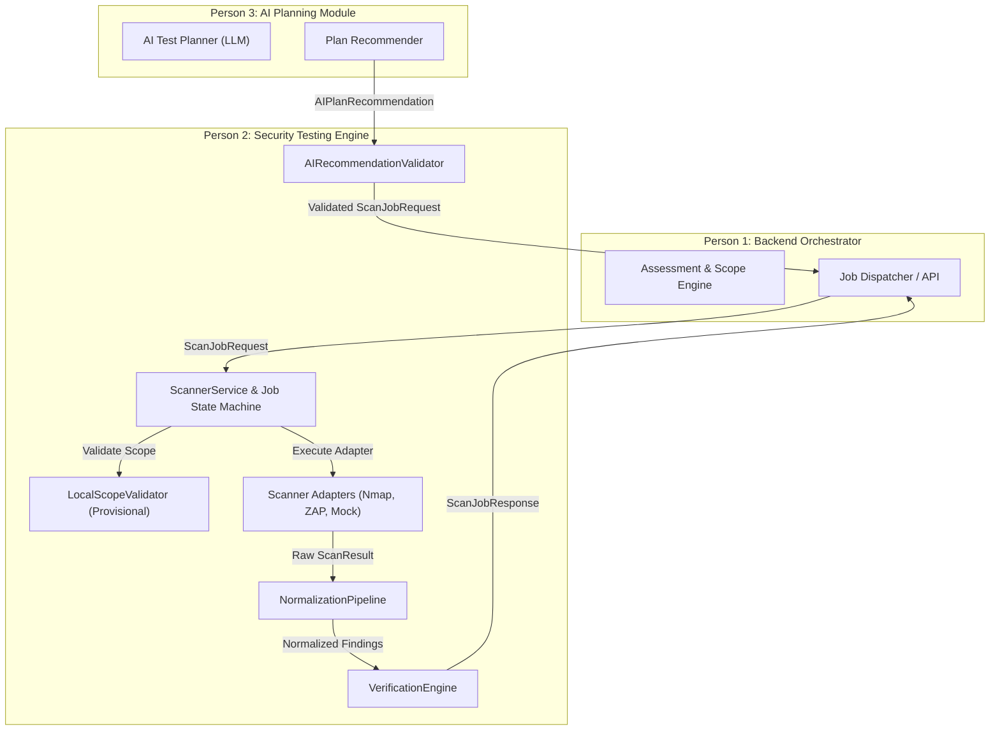

# AegisPT — Backend and AI Planner Integration (Stage 9)

## 1. Overview & Architectural Boundaries

In Stage 9, **Person 2's Security Testing Engine** (`aegispt.security_engine`) is formally interfaced with:
- **Person 1's Backend / Orchestrator**: Responsible for assessment management, authoritative customer scope, asset inventories, and job dispatching.
- **Person 3's AI Test Planner**: Responsible for heuristic scanning recommendations, test category selection, and report summarization.



---

## 2. Team Responsibility Matrix

| Module / Responsibility | Owner | Authoritative Source | Person 2's Boundary & Role |
| :--- | :---: | :---: | :--- |
| **Assessment & Scope** | Person 1 | Customer ROE & Engagement Contract | Enforces scope via `BaseScopeValidator` / `LocalScopeValidator`. Rejects public/out-of-scope targets at `POLICY_CHECK`. |
| **Job Lifecycle & API** | Person 1 | Backend DB & Task Queue | Manages state machine (`CREATED` -> `COMPLETED`) via `ScannerService` and returns immutable transitions. |
| **AI Test Planning** | Person 3 | LLM Agent Reasoning | Validates recommendations via `AIRecommendationValidator`. AI has **zero** authoritative authority over execution. |
| **Scanner Execution** | Person 2 | Adapter Interfaces | Safely executes CLI/API tools (`nmap`, `owasp_zap`, `mock_scanner`) with strict subprocess boundaries. |
| **Normalization & Evidence** | Person 2 | Finding Schema & Hash Audits | Canonicalizes vendor outputs into `NormalizedFinding` and binds immutable SHA-256 evidence. |
| **Finding Verification** | Person 2 | Deterministic Verification Plugins | Verifies findings against evidence and live lab probes (`CONFIRMED`, `LIKELY`, `FALSE_POSITIVE`, `UNVERIFIED`). |

---

## 3. Core Integration Contracts

### 3.1 Job Request (`ScanJobRequest`)
Person 1 dispatches scan tasks to `ScannerService.run_job(...)` using `ScanJobRequest`:
```python
class ScanJobRequest(BaseModel):
    job_id: str                      # Tracing ID
    assessment_id: str               # Parent engagement ID
    asset_id: str                    # Backend asset entity ID
    target: ScanTarget               # Target value, type, ports, is_in_scope flag
    scanner_id: str                  # 'mock_scanner', 'nmap', 'owasp_zap'
    profile_id: str                  # Approved scan profile
    permission_level: PermissionLevel# SAFE_AUDIT, ACTIVE_PROBE, INTRUSIVE
    resource_budget: ResourceBudget  # max_cpu_percent, max_memory_mb, max_rate_limit
    approved_by_operator: bool       # Sign-off for intrusive profiles
    options: dict[str, Any]          # Optional flags or simulation directives
```

### 3.2 Job Lifecycle State Machine (`JobStatus`)
`ScannerService` tracks all jobs through 9 predictable lifecycle states:

```
[CREATED] ──> [POLICY_CHECK] ──> [QUEUED] ──> [RUNNING] ──> [REVIEW] ──> [COMPLETED]
                    │                              │
                    ├──> [NEEDS_APPROVAL]          ├──> [FAILED]
                    │                              │
                    └──> [FAILED]                  └──> [CANCELLED]
```

- `CREATED`: Syntactically valid request ingested.
- `POLICY_CHECK`: Checked against scope rules, approved profile registry, and permission level.
- `NEEDS_APPROVAL`: Profile has high operational impact (`requires_human_approval=True`) and operator sign-off is absent.
- `QUEUED`: Enqueued awaiting runner execution.
- `RUNNING`: Scanner process or API scan actively executing with monitored timeout.
- `REVIEW`: Scanner completed; findings undergo normalization, deduplication, and multi-step verification.
- `COMPLETED`: Terminal state; all findings normalized and verified.
- `FAILED`: Terminal state; failed during policy check, scanner runtime error, or timeout.
- `CANCELLED`: Terminal state; cancelled by operator or orchestrator via `service.cancel_job(job_id)`.

---

## 4. AI Planner Gatekeeping (`AIRecommendationValidator`)

Person 3's AI Planning module recommends scans via `AIPlanRecommendation`. Person 2's `AIRecommendationValidator` acts as the strict gatekeeper:

### Rejection Policy:
1. **Unregistered Scanner**: AI requests a tool not in the registry $\rightarrow$ `AIRecommendationValidationError`.
2. **Unapproved Profile**: AI constructs an arbitrary profile name or flags $\rightarrow$ `AIRecommendationValidationError`.
3. **Incompatible Pairing**: AI requests Nmap profiles for ZAP or vice versa $\rightarrow$ `AIRecommendationValidationError`.
4. **Scope Violation**: AI recommends an external IP, public domain, or `is_in_scope=False` $\rightarrow$ `AIRecommendationValidationError`.
5. **Insufficient Permission**: AI requests intrusive scans without sufficient permission tier $\rightarrow$ `AIRecommendationValidationError`.
6. **Excessive Resource Budget**: AI proposes resource requests exceeding platform ceilings $\rightarrow$ `AIRecommendationValidationError`.
7. **Malformed Evidence References**: AI supplies path traversal or malformed strings $\rightarrow$ `AIRecommendationValidationError`.

---

## 5. Result Handling (`ScanJobResponse`)

Upon termination, `ScannerService` returns a comprehensive `ScanJobResponse` to Person 1:
- `job_id`: Unique identifier of the completed job.
- `status`: Final `JobStatus` enum value.
- `scanner_metadata`: Tool version, vendor, and capability report.
- `duration_seconds`: Total wall-clock execution duration.
- `findings`: List of `NormalizedFinding` objects with CWEs, CVEs, and fingerprints.
- `evidence_references`: Preserved SHA-256 evidence artifact IDs and file paths.
- `verification_summary`: Map of `finding_id -> VerificationStatus` (`CONFIRMED`, `LIKELY`, etc.).
- `error`: Structured `ScannerExecutionError` if the job failed.
- `logs`: Chronological audit log of state transitions.

---

## 6. Verification & Test Summary

All integration scenarios are verified in `tests/unit/test_stage9_integration.py`:
- 20 comprehensive unit and integration tests passing.
- 126 total tests passing across the entire AegisPT security engine suite.
- Execution time: ~2.8s.
- Zero external network exposure during test execution.
