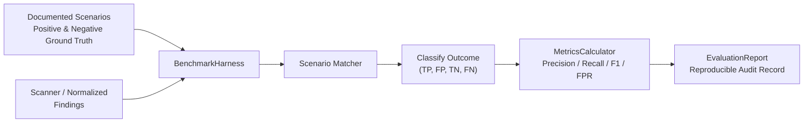

# AegisPT: Reproducible Security Testing Evaluation Framework

This document details the architecture, statistical formulas, ground truth benchmark scenarios, and reproducibility guidelines for the **AegisPT Evaluation Framework** (`aegispt.security_engine.evaluation`).

---

## 1. Overview & Benchmark Objectives

To scientifically evaluate scanner integrations (Nmap, OWASP ZAP) and the verification subsystem, the platform implements a controlled, reproducible benchmarking harness.

### Guiding Principles:
1. **Independent Ground Truth:** Ground truth values are derived strictly from documented application architecture and intentional laboratory design—**never** inferred from scanner outputs.
2. **Localhost & Lab Isolation:** Benchmarks execute exclusively against deliberately vulnerable local applications (e.g. OWASP Juice Shop).
3. **Statistical Rigor:** Evaluates both positive samples (vulnerabilities present) and negative samples (defended/benign controls) to compute balanced confusion matrices.



---

## 2. Documented Ground Truth Scenarios (OWASP Juice Shop)

The benchmark includes both positive and negative scenarios defined in [`aegispt/security_engine/evaluation/scenarios.py`](file:///c:/Users/JASIF/OneDrive/Desktop/Idea/aegispt/security_engine/evaluation/scenarios.py):

| Scenario ID | Endpoint | Vulnerability | Ground Truth | Expected Behavior | Description |
|---|---|---|---|---|---|
| `SCN-JUICE-XSS-01` | `/#/search?q=` | `CWE-79` | **True** (Vulnerable) | `DETECT_ALERT` | Reflected XSS in search query string |
| `SCN-JUICE-SQLI-01`| `/rest/user/login` | `CWE-89` | **True** (Vulnerable) | `DETECT_ALERT` | Classic SQLi in user login authentication |
| `SCN-JUICE-CSP-01` | `/` | `CWE-693`| **True** (Vulnerable) | `DETECT_ALERT` | Missing Content-Security-Policy header |
| `SCN-JUICE-CSRF-01`| `/rest/user/change-password` | `CWE-352` | **True** (Vulnerable) | `DETECT_ALERT` | Missing Anti-CSRF on state-changing forms |
| `SCN-JUICE-DEF-SQLI-01`| `/api/SecurityQuestions` | `CWE-89` | **False** (Defended) | `NO_ALERT` | Parameterized ORM queries preventing SQLi |
| `SCN-JUICE-DEF-XSS-01` | `/public/images` | `CWE-79` | **False** (Defended) | `NO_ALERT` | Static image delivery preventing script execution |
| `SCN-JUICE-DEF-PASS-01`| `/api/Users` | `CWE-256`| **False** (Defended) | `NO_ALERT` | Modern bcrypt/PBKDF2 credential hashing |

---

## 3. Evaluation Metrics & Zero-Denominator Handling

The [`MetricsCalculator`](file:///c:/Users/JASIF/OneDrive/Desktop/Idea/aegispt/security_engine/evaluation/metrics.py) evaluates outcomes into four categories:
- **True Positive ($TP$):** Ground truth is `True` and finding was detected.
- **False Positive ($FP$):** Ground truth is `False` but scanner incorrectly reported a flaw.
- **True Negative ($TN$):** Ground truth is `False` and scanner correctly reported no flaw.
- **False Negative ($FN$):** Ground truth is `True` but scanner failed to detect the flaw.

### Mathematical Formulas & Boundary Fallbacks:

1. **Precision:**
   $$\text{Precision} = \begin{cases} \frac{TP}{TP + FP} & \text{if } (TP + FP) > 0 \\ 0.0 & \text{otherwise} \end{cases}$$

2. **Recall (Sensitivity):**
   $$\text{Recall} = \begin{cases} \frac{TP}{TP + FN} & \text{if } (TP + FN) > 0 \\ 0.0 & \text{otherwise} \end{cases}$$

3. **F1 Score:**
   $$\text{F1} = \begin{cases} \frac{2 \times \text{Precision} \times \text{Recall}}{\text{Precision} + \text{Recall}} & \text{if } (\text{Precision} + \text{Recall}) > 0 \\ 0.0 & \text{otherwise} \end{cases}$$

4. **False-Positive Rate (Fall-out):**
   $$\text{FPR} = \begin{cases} \frac{FP}{FP + TN} & \text{if } (FP + TN) > 0 \\ 0.0 & \text{otherwise} \end{cases}$$

5. **Scan Completion Rate:**
   $$\text{Completion Rate} = \frac{\text{Completed Scans}}{\text{Total Scans}}$$

6. **Average Runtime:**
   $$\text{Avg Runtime} = \frac{\text{Total Runtime}}{\text{Total Scans}}$$

---

## 4. Structured Evaluation Report

Reports are serialized via [`EvaluationReport`](file:///c:/Users/JASIF/OneDrive/Desktop/Idea/aegispt/security_engine/evaluation/models.py):

```json
{
  "report_id": "rep-7f8b9a1c2d3e",
  "timestamp": "2026-10-24T21:00:00Z",
  "scanner_id": "owasp_zap",
  "scanner_version": "2.14.0",
  "scan_profile": "zap_passive_baseline",
  "lab_application": "OWASP Juice Shop",
  "lab_version": "17.1.1",
  "dataset_version": "1.0.0",
  "total_scenarios": 7,
  "detection_results": {
    "detected": 4,
    "undetected": 3
  },
  "metrics": {
    "total_scenarios": 7,
    "true_positives": 4,
    "false_positives": 0,
    "true_negatives": 3,
    "false_negatives": 0,
    "precision": 1.0,
    "recall": 1.0,
    "f1_score": 1.0,
    "false_positive_rate": 0.0,
    "scan_completion_rate": 1.0,
    "average_runtime_seconds": 1.7857
  }
}
```

---

## 5. Reproducibility Protocol

To reproduce any benchmark:
1. Ensure the local lab is running at the recorded version (`OWASP Juice Shop v17.1.1`).
2. Execute the lab reset procedure:
   ```powershell
   cd lab
   docker compose down -v && docker compose up -d
   ```
3. Run the evaluation harness using the recorded `dataset_version` and `scan_profile`.

---

## 6. Known Limitations

1. **SPA Crawling Dependency:** In single-page JavaScript applications, traditional spiders can miss hash-based routes (`/#/search`) unless headless DOM exploration (Ajax Spider) is active.
2. **Deterministic Lab State:** Active scans that alter application state (e.g. changing admin passwords) must be preceded by a clean container reset to prevent cross-scenario contamination.
