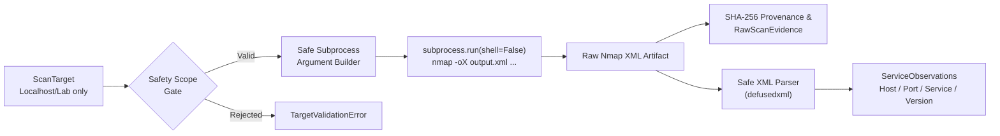

# AegisPT: Nmap Scanner Adapter

This document details the architecture, configuration, security controls, XML parsing, and operational guidelines for the **Nmap Scanner Adapter** (`aegispt.security_engine.integrations.nmap`).

---

## 1. Overview & Architecture

The Nmap adapter provides active service discovery and port enumeration for the AegisPT security testing platform. It wraps the native `nmap` binary, enforces strict target boundaries, invokes the tool with predefined arguments via safe subprocess isolation, extracts structured XML output (`-oX`), and normalizes the results into factual `ServiceObservation` schemas.



---

## 2. Nmap Installation

The adapter requires the `nmap` CLI utility on the host system:

### Windows:
1. Download the latest installer (e.g. `nmap-7.95-setup.exe`) from the [official Nmap download page](https://nmap.org/download.html).
2. Run the installer and ensure Npcap and command-line tools are selected.
3. Verify that `C:\Program Files (x86)\Nmap` is added to your system `PATH`.
4. Test installation in PowerShell:
   ```powershell
   nmap --version
   ```

### Linux (Debian / Ubuntu):
```bash
sudo apt-get update && sudo apt-get install -y nmap
nmap --version
```

### macOS (Homebrew):
```bash
brew install nmap
nmap --version
```

---

## 3. Predefined Scan Profiles

To prevent arbitrary command generation or flag injection, the adapter exclusively accepts predefined profiles registered in [`APPROVED_SCAN_PROFILES`](file:///c:/Users/JASIF/OneDrive/Desktop/Idea/aegispt/security_engine/schemas/profile.py):

| Profile ID | Purpose | Underlying Arguments | Output Format |
|---|---|---|---|
| `nmap_fast_discovery` | Rapid host check across top 100 ports | `-F -T4 -Pn --no-stylesheet` | Structured XML |
| `nmap_service_version` | Service identification and version extraction | `-sV --version-light -T4 -Pn --no-stylesheet` | Structured XML |
| `nmap_custom_ports` | Targeted inspection of target-specified ports | `-p <ports> -sV -T4 -Pn --no-stylesheet` | Structured XML |

---

## 4. Security & Isolation Controls

1. **Deterministic Subprocess Execution:**
   - The adapter executes `subprocess.run(cmd_args, shell=False, timeout=timeout)`.
   - Never uses shell string concatenation (`shell=True`), preventing command injection.
2. **Local Scope Gating:**
   - Targets are validated via `target.is_local_or_private()`.
   - Any public internet IP or unauthorized host domain is rejected with a `TargetValidationError` prior to tool execution.
3. **Shell Character Sanitization:**
   - Input targets containing shell metacharacters (`;`, `&`, `|`, `` ` ``, `$`, `<`, `>`) are rejected.
4. **Audit Provenance:**
   - The raw XML report is stored in `artifacts/scans/nmap_{request_id}.xml`.
   - A cryptographic SHA-256 digest is generated and attached to `RawScanEvidence` before parsing.

---

## 5. XML Parsing & Telemetry Normalization

Nmap's terminal text output is subject to formatting variations. The adapter strictly parses machine-readable XML (`-oX`) using `defusedxml.ElementTree`:

### Extracted Fields:
- **Host Address:** Evaluates `<address>` nodes, prioritizing IPv4 / IPv6 over MAC addresses.
- **Hostname:** Extracted from `<hostnames><hostname name="..."/></hostnames>` if present.
- **Port:** Parsed from `<port portid="..." protocol="...">`.
- **Port State:** Extracted from `<state state="...">` (`open`, `closed`, `filtered`).
- **Service Telemetry:** Extracted from optional `<service name="..." product="..." version="..." extrainfo="...">`.

### Separation of Observations vs. Vulnerabilities:
> [!IMPORTANT]
> **Zero False Vulnerability Policy:** An open port is a factual operational state, **not** a vulnerability. The adapter normalizes open/closed ports as [`ServiceObservation`](file:///c:/Users/JASIF/OneDrive/Desktop/Idea/aegispt/security_engine/schemas/observation.py) records, populating `ScanResult.observations`. `ScanResult.findings` remains empty during basic discovery, preventing false-positive clutter.

---

## 6. Known Limitations

1. **Privilege Requirements:**
   - SYN stealth scans (`-sS`) require root on Linux or administrative privileges on Windows. The adapter defaults to unprivileged TCP connect probes (`-Pn` with TCP probes) so it can run under standard user permissions.
2. **Localhost Windows Nuances:**
   - On Windows, scanning `127.0.0.1` bypasses the Npcap driver and uses standard Windows socket calls; some advanced raw-packet flags (like `-O` OS detection) may not be available on loopback without elevated Npcap loopback drivers.
3. **Missing Tool Fallback:**
   - If Nmap is not installed in the operating environment, the adapter returns a structured `ScanResult` with `ScanStatus.FAILED` and error code `NMAP_NOT_INSTALLED`, preventing application crashes.
