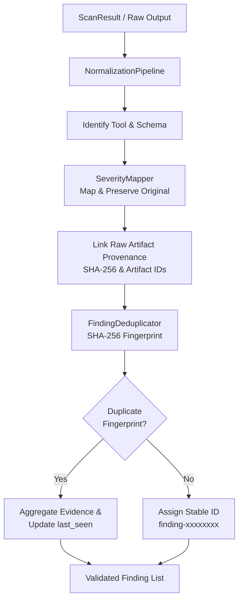

# AegisPT: Common Finding Normalization Engine

This document details the architecture, data pipeline, deduplication strategy, severity mapping policies, and operational boundaries of the **AegisPT Finding Normalization Engine** (`aegispt.security_engine.normalization`).

---

## 1. Overview & Objectives

In a multi-scanner assessment ecosystem (integrating network scanners like Nmap and web scanners like OWASP ZAP), raw outputs exhibit divergent structures, severity semantics, and confidence representations.

The Normalization Engine converts raw scanner results into a unified, vendor-agnostic [`NormalizedFinding`](file:///c:/Users/JASIF/OneDrive/Desktop/Idea/aegispt/security_engine/schemas/finding.py) model. This allows Person 3 (AI analysis layer) to reason over attack paths and Person 1 (central backend) to persist structured findings without maintaining parser logic for individual scanning tools.

---

## 2. The 9-Stage Normalization Pipeline

When [`NormalizationPipeline.normalize_scan_result()`](file:///c:/Users/JASIF/OneDrive/Desktop/Idea/aegispt/security_engine/normalization/pipeline.py) receives an assessment result, it executes the following steps:

1. **Ingestion:** Accepts a completed `ScanResult` instance.
2. **Scanner Identification:** Detects scanner identity (`scanner_id: 'owasp_zap'`, `'nmap'`, etc.).
3. **Input Validation:** Verifies schema structure and required fields.
4. **Telemetry vs. Vulnerability Gate:** Enforces the platform policy that Nmap open ports remain factual `ServiceObservation` records and are not fabricated into vulnerability findings.
5. **Severity Normalization:** Standardizes risk ratings to the common `Severity` enum (`INFO`, `LOW`, `MEDIUM`, `HIGH`, `CRITICAL`) while retaining `original_severity`.
6. **Asset Association:** Associates findings with the target asset (`asset_id` and `target`).
7. **Evidence Provenance Linking:** Propagates raw artifact IDs and SHA-256 hashes from `RawScanEvidence` into each `EvidenceReference`.
8. **Stable Identifier Generation:** Calculates a deterministic SHA-256 fingerprint from immutable finding traits, generating a stable ID (`finding-<fingerprint[:16]>`).
9. **Deduplication:** Aggregates redundant observations into consolidated records.

---

## 3. Supported Finding Schema Fields

The [`NormalizedFinding`](file:///c:/Users/JASIF/OneDrive/Desktop/Idea/aegispt/security_engine/schemas/finding.py) model provides comprehensive coverage across collaborative modules:

| Field Name | Type | Description |
|---|---|---|
| `finding_id` | `str` | Stable identifier generated deterministically from fingerprint |
| `assessment_id` | `str \| None` | Identifier of the assessment engagement or job scope |
| `asset_id` | `str \| None` | Identifier of affected asset (defaults to `target.target_id`) |
| `title` | `str` | Human-readable title of the vulnerability |
| `description` | `str` | Verbatim or parsed technical description |
| `severity` | `Severity` | Common enum (`INFO`, `LOW`, `MEDIUM`, `HIGH`, `CRITICAL`) |
| `original_severity`| `str \| None` | Preserved unmapped severity from scanner (e.g., `'Medium (High)'`) |
| `confidence` | `str \| None` | Tool confidence level (`'High'`, `'Medium'`, `'False Positive'`) |
| `verification_status`| `str` | `'UNVERIFIED'` (default) or `'CONFIRMED'` |
| `evidence_ids` | `list[str]` | IDs referencing supporting evidence instances |
| `cwe` / `cwe_id` | `str` / `int` | Standardized Common Weakness Enumeration identifiers |
| `cve` / `cve_id` | `str` | Standardized CVE identifiers if known |
| `root_cause` | `str \| None` | Underlying flaw causing the vulnerability |
| `remediation` | `str \| None` | Recommended mitigation advice |
| `tool_name` | `str` | Name of the tool reporting the observation |
| `tool_version` | `str \| None` | Version of the tool or adapter |
| `first_seen` | `datetime` | UTC timestamp of initial observation |
| `last_seen` | `datetime` | UTC timestamp of most recent observation |
| `fingerprint` | `str` | SHA-256 deterministic fingerprint |

---

## 4. Deterministic Deduplication Strategy

Repeated scan runs or multi-phase scans frequently re-discover the same vulnerability. Rather than generating bloated, redundant findings, the engine uses a deterministic hashing strategy:

### Fingerprint Formulation:
$$\text{Fingerprint} = \text{SHA256}(\text{assessment\_key} : \text{asset\_key} : \text{target\_val} : \text{vuln\_type} : \text{param\_key} : \text{rule\_key})$$

- **Asset Isolation Guarantee:** The fingerprint includes `target_val` and `asset_key`. Findings on `http://127.0.0.1:3000/app1` and `http://127.0.0.1:3000/app2` produce distinct fingerprints and are **never** merged.
- **Evidence Aggregation:** When a duplicate finding is identified, the existing finding's `last_seen` timestamp is bumped, and novel evidence snippets/payloads are merged into the existing finding's `evidence` list without duplicates.

---

## 5. Explicit Severity Mapping Policies

| Scanner | Raw Value | Normalized Severity | Operational Rationale |
|---|---|---|---|
| **ZAP** | `High` / `3` | `Severity.HIGH` | Direct exploitability or severe impact |
| **ZAP** | `Medium` / `2` | `Severity.MEDIUM` | Security controls missing or conditional impact |
| **ZAP** | `Low` / `1` | `Severity.LOW` | Hardening or minor defense-in-depth deviation |
| **ZAP** | `Informational` / `0` | `Severity.INFO` | Non-exploitable advisory or server header notice |
| **Nmap** | `open` | `Severity.INFO` | Open ports represent service telemetry, not vulnerabilities |
| **Generic**| Substring match | Inferred Severity | Fallback heuristic (`CRITICAL` / `HIGH` / `MEDIUM` / `LOW` / `INFO`) |

---

## 6. Known Limitations

1. **Parameter Disambiguation in SPAs:**
   - Single-page applications routing dynamically through client-side query fragments (e.g., `/#/search?q=1`) may report URL roots identically unless the crawler preserves hash fragments.
2. **Third-party Schema Drift:**
   - Changes in upstream scanner rule identifiers (e.g. ZAP plugin ID deprecations) can alter fingerprint generation across major scanner upgrades.
3. **Cross-Scanner Correlation:**
   - Stage 6 deduplicates within and across scans based on rule IDs and parameters. Correlating disparate scanners detecting the exact same flaw under different titles (e.g., a custom script vs. ZAP rule) will be handled in Stage 7 via verification correlation.
