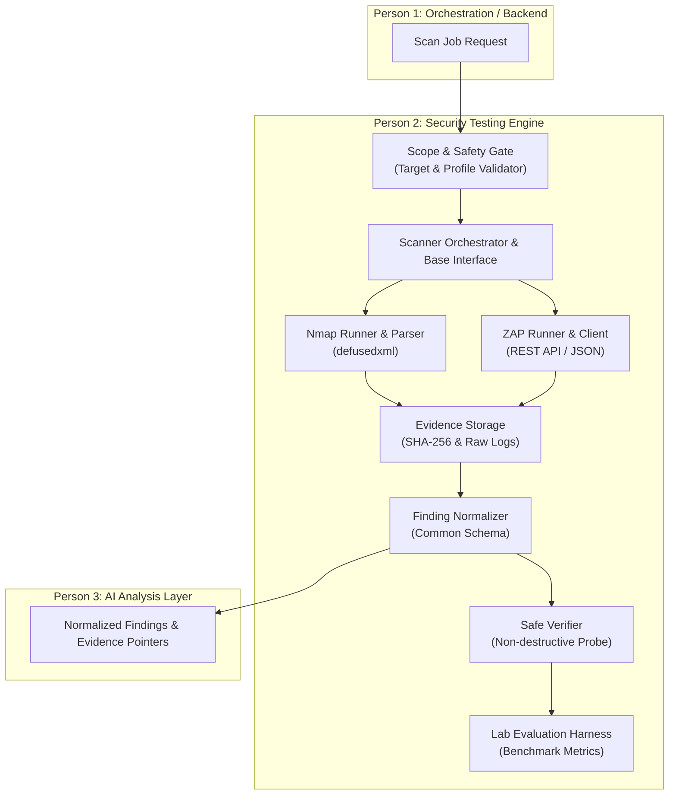

# AegisPT: Person 2 - Security Testing Engine Architecture & Design

## 1. Overview and Scope

**Person 2** is responsible for designing, building, and evaluating the **Security Testing Engine** within the **AegisPT** (ZeroTrace) research platform.

The engine serves as the execution and normalization bridge between authorized assessment requests and underlying security tools (such as Nmap and OWASP ZAP). It guarantees safe execution boundaries, structured parsing, audit evidence preservation, finding normalization, and non-destructive verification.

---

## 2. Security Guardrails & Safety Policy

Security assessment tools are high-privilege and high-risk by nature. To adhere to research ethics and prevent collateral damage or unauthorized network access, the Security Testing Engine enforces strict operational boundaries:

1. **Target Scope Restrictions:**
   - Default authorized targets are restricted strictly to `localhost` (`127.0.0.1`, `::1`) and local Docker bridge networks (e.g., `172.16.0.0/12` lab containers).
   - Arbitrary public IP addresses or non-whitelisted domains are rejected at schema validation time prior to any tool invocation.
2. **Deterministic Invocation (No Shell Generation):**
   - The engine never invokes a shell (`shell=False` in subprocess).
   - Scanners are called via predefined, strictly parameterized argument lists.
   - AI models (from Person 3) or external inputs (from Person 1) are never permitted to generate or concatenate raw shell command strings.
3. **Approved Scan Profiles:**
   - Tools may only run under whitelisted, pre-configured profiles (e.g., `discovery_quick`, `service_version`, `web_baseline`).
   - Arbitrary flag injection is strictly blocked.
4. **Non-Destructive Operations:**
   - Active attacks such as credential brute-forcing, denial of service, memory corruption payloads, automated persistence, or arbitrary code execution are expressly disallowed.
   - Verification stages only confirm finding conditions via non-destructive probes (e.g., header checks, passive evidence confirmation, or safe benign input reflection).
5. **Bounded Execution & Resource Limits:**
   - Every scanner process is bounded by strict per-task timeouts (e.g., 300s default) and process termination routines to prevent zombie scans and CPU starvation.
6. **Immutable Evidence Preservation:**
   - All raw tool outputs (Nmap XML, ZAP JSON/HAR) are preserved alongside a SHA-256 digest for reproducibility and forensic verification before normalization.

---

## 3. High-Level Architecture



---

## 4. Component Directory Structure

```text
aegispt/
├── __init__.py
└── security_engine/
    ├── __init__.py
    ├── core/
    │   ├── __init__.py
    │   ├── config.py         # Engine settings, timeouts, safe IP whitelists
    │   ├── exceptions.py     # Engine exception hierarchy
    │   └── safety.py         # Scope validation, target sanitization, profile gating
    ├── schemas/
    │   ├── __init__.py
    │   ├── target.py         # Target definitions (IP, Hostname, PortRange, Protocol)
    │   ├── profile.py        # Validated scan profiles and bounded options
    │   ├── finding.py        # Normalized finding model (CWE, CVE, severity, evidence)
    │   └── result.py         # Scan execution summary, timing, raw output paths
    ├── integrations/
    │   ├── __init__.py
    │   ├── base.py           # Abstract BaseScanner class (run, parse, normalize)
    │   ├── nmap/
    │   │   ├── __init__.py   # Nmap execution wrapper and defusedxml parser
    │   │   └── profiles.py   # Approved Nmap execution argument templates
    │   └── zap/
    │       ├── __init__.py   # OWASP ZAP API wrapper and JSON parser
    │       └── profiles.py   # Approved ZAP policy profiles
    ├── verification/
    │   ├── __init__.py
    │   └── base.py           # Verification engine for non-destructive finding validation
    ├── storage/
    │   ├── __init__.py
    │   └── evidence.py       # Artifact storage with SHA-256 integrity tracking
    └── evaluation/
        ├── __init__.py
        ├── harness.py        # Testbench runner against target lab environments
        └── metrics.py        # Precision, recall, false discovery rate calculators
```

---

## 5. Interface Contracts with Collaborators

### A. Interface with Person 1 (Backend / Orchestrator)
- **Input:** Person 1 sends a structured `ScanTarget` and `ScanProfileName`.
- **Validation:** Person 2's engine executes `safety.validate_target(target)` before accepting.
- **Execution:** Engine asynchronously invokes the requested scanner, logs progress events, and returns a `ScanResult`.
- **Output:** Returns normalized `ScanResult` including timestamps, execution status, evidence hashes, and normalized findings list.

### B. Interface with Person 3 (AI Analysis & Reporting)
- **Data Product:** Person 2 supplies `List[NormalizedFinding]`.
- **Finding Content:**
  - Standardized severity (`INFO`, `LOW`, `MEDIUM`, `HIGH`, `CRITICAL`).
  - Standard identifiers (`CWE`, `CVE`, `WASC`).
  - Extracted evidence snippet (HTTP request/response snippet, banner, port state).
  - Absolute path and SHA-256 hash of the raw scanner log for chain-of-custody verification.
  - Safe verification status (`UNVERIFIED`, `CONFIRMED`, `INCONCLUSIVE`).
- Person 3 consumes these models to perform risk scoring, attack-graph generation, and remediation drafting without dealing with raw tool-specific syntax.

---

## 6. Incremental Roadmap for Person 2

| Stage | Focus Area | Deliverables |
|---|---|---|
| **Stage 1 (Current)** | Repository setup & architecture | Directory structure, docs, configuration, packaging, and smoke tests |
| **Stage 2** | Common Pydantic schemas | `Target`, `ScanProfile`, `NormalizedFinding`, and `ScanResult` models |
| **Stage 3** | Target validation & Safety Guardrails | IP/Host parser, localhost/Docker CIDR checks, command-line argument sanitizer |
| **Stage 4** | Nmap Scanner Integration | Argument builder, subprocess runner with timeout, `defusedxml` parser |
| **Stage 5** | Raw Evidence Storage & Integrity | Artifact directory manager, SHA-256 provenance logging |
| **Stage 6** | OWASP ZAP Scanner Integration | REST API harness, scan policies, structured JSON alert parser |
| **Stage 7** | Safe Finding Verification | Non-destructive probe checks for candidate findings |
| **Stage 8** | Lab Evaluation Harness | Benchmark suite against deliberately vulnerable apps (e.g., OWASP Juice Shop) |
