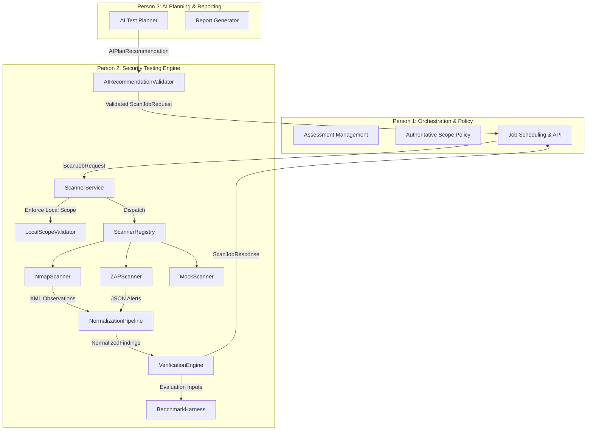

# AegisPT Security Testing Engine — Operator & Developer Manual

> **Persona**: Person 2 (Security Testing Engine)  
> **Status**: Stage 10 Research Prototype  
> **Version**: 0.1.0  
> **Target Audience**: Core Cybersecurity Engineering Team (Person 1, Person 2, Person 3)

---

## 1. Architecture Explanation

The AegisPT Security Testing Engine (`aegispt.security_engine`) provides a modular, safe, and verifiable execution pipeline for vulnerability discovery, factual service telemetry, and deterministic finding verification.

### 1.1 Separation of Responsibilities



- **Person 1 (Backend & Orchestration)**: Owns persistent asset models, overall assessment lifecycle, client ROE (Rules of Engagement), and API endpoints.
- **Person 2 (Security Testing Engine)**: Owns scanner adapter execution, subprocess isolation, finding normalization, evidence hashing, and deterministic verification.
- **Person 3 (AI Test Planning)**: Recommends candidate scans, hypothesizes attack chains, and formats executive summaries. Person 3 has **zero direct execution authority**.

---

## 2. Installation Guide

### 2.1 System Prerequisites
- **Operating System**: Linux (Ubuntu 22.04+), macOS (13+), or Windows 10/11.
- **Python Runtime**: Python 3.10, 3.11, 3.12, 3.13, or 3.14.
- **External Binaries (Optional for simulated tests; required for live scanning)**:
  - **Nmap**: Version 7.90 or higher.
  - **OWASP ZAP**: Version 2.14.0 or higher (or Docker container).
  - **Docker Engine & Docker Compose**: For hosting the local OWASP Juice Shop lab.

### 2.2 Installing the Security Engine
1. Clone the repository and checkout the active branch:
   ```bash
   git clone https://github.com/sahil-mss/ZeroTrace.git
   cd ZeroTrace
   git checkout feature/person-2-security-engine
   ```

2. Create and activate a dedicated virtual environment:
   ```bash
   python -m venv .venv
   # Windows PowerShell
   .venv\Scripts\Activate.ps1
   # Linux / macOS
   source .venv/bin/activate
   ```

3. Install project dependencies:
   ```bash
   pip install -r requirements.txt
   pip install -r requirements-dev.txt
   ```

---

## 3. Configuration Guide

### 3.1 Environment Variables
All configuration follows the **12-Factor App** pattern. Secrets and configuration are loaded dynamically:

| Variable | Description | Default |
| :--- | :--- | :--- |
| `AEGISPT_ZAP_API_KEY` | API Key for OWASP ZAP REST API | `None` (Disabled / Anonymous) |
| `AEGISPT_ZAP_HOST` | Host IP for ZAP Daemon | `127.0.0.1` |
| `AEGISPT_ZAP_PORT` | Port for ZAP REST API | `8080` |
| `AEGISPT_LAB_URL` | Base URL of local testing lab | `http://127.0.0.1:3000` |
| `AEGISPT_ARTIFACTS_DIR` | Directory for raw XML/JSON evidence | `artifacts/scans` |

### 3.2 Approved Scan Profiles
Predefined scan profiles prevent arbitrary command generation:
- `mock_baseline`: Non-intrusive mock profile for smoke testing.
- `mock_intrusive_approval`: Intrusive mock profile requiring human sign-off.
- `nmap_fast_discovery`: Fast top-100 port scan (`-F -T4 -Pn`).
- `nmap_service_version`: Service version probe (`-sV --version-light -T4 -Pn`).
- `nmap_custom_ports`: User-specified port list inspection.
- `zap_passive_baseline`: Passive spidering and alert collection without injection.
- `zap_active_baseline`: Active vulnerability probing (requires human approval).

---

## 4. Scanner Integration Guide

All scanners must inherit from `BaseScanner` (`aegispt.security_engine.integrations.base`):

```python
from aegispt.security_engine.integrations.base import BaseScanner
from aegispt.security_engine.schemas.result import ScannerMetadata, ScanRequest, ScanResult

class CustomScanner(BaseScanner):
    def get_metadata(self) -> ScannerMetadata:
        ...
    def validate_target(self, target: ScanTarget) -> bool:
        ...
    def validate_profile(self, profile: ScanProfile) -> bool:
        ...
    def run_scan(self, request: ScanRequest) -> ScanResult:
        ...
    def parse_results(self, raw_evidence: RawScanEvidence) -> list[NormalizedFinding]:
        ...
```

### Safety Rules for Adapters:
1. **Never use `shell=True`**: All CLI tools must be called with argument vectors (`list[str]`).
2. **Strict Timeouts**: Pass `timeout=request.timeout_seconds` to `subprocess.run` or `requests.get`.
3. **Capture Telemetry Separately**: Separate factual observations (`ServiceObservation`) from vulnerabilities (`NormalizedFinding`).
4. **Preserve Raw Evidence**: Hash raw stdout/XML/JSON with SHA-256 before parsing.

---

## 5. Lab Setup Guide (OWASP Juice Shop)

The local testbed is isolated to the loopback interface (`127.0.0.1`):

### 5.1 Starting the Lab
```bash
cd lab
docker compose up -d
```

### 5.2 Verifying Lab Reachability
```bash
curl -I http://127.0.0.1:3000
```
Or run the built-in lab manager:
```bash
python -c "from aegispt.security_engine.evaluation.lab_manager import LabManager; print(LabManager.from_file('lab/lab_config.json').get_readiness_report())"
```

### 5.3 Resetting the Lab
To wipe all state and restore default synthetic data:
```bash
cd lab
docker compose down -v
docker compose up -d
```

---

## 6. Testing Guide

AegisPT uses `pytest` for all unit, integration, and security verification tests.

### 6.1 Running the Full Suite
```bash
pytest -v
```

### 6.2 Running Targeted Subsystem Tests
```bash
# Unit & Schema Tests
pytest tests/unit/test_schemas.py tests/unit/test_mock_scanner.py

# Nmap and ZAP Adapter Tests
pytest tests/unit/test_nmap_adapter.py tests/unit/test_nmap_parser.py
pytest tests/unit/test_zap_adapter.py tests/unit/test_zap_parser.py

# Scope and Policy Check Tests
pytest tests/unit/test_stage9_integration.py -k "Scope"

# Verification Engine Tests
pytest tests/unit/test_verification.py

# Evaluation Benchmark Tests
pytest tests/unit/test_evaluation.py
```

---

## 7. Troubleshooting Guide

| Problem | Cause | Resolution |
| :--- | :--- | :--- |
| `NMAP_NOT_INSTALLED` | `nmap` binary is missing from system PATH. | Install Nmap (`sudo apt install nmap` or installer on Windows) or run in simulation mode with fixtures. |
| `ZAP_UNAVAILABLE` | ZAP daemon is not listening on port 8080. | Start ZAP daemon with `-daemon -port 8080` or pass `simulated_alerts_json`. |
| `SCOPE_VIOLATION` | Target is external, public IP, or has `is_in_scope=False`. | Check target value; ensure destination is `127.0.0.1` or loopback lab. |
| `NEEDS_APPROVAL` | Profile requires human sign-off. | Set `approved_by_operator=True` in `ScanJobRequest`. |
| `EPERM` on mkdir in sandbox | Transient sandbox permission lock. | Re-run command or execute with direct virtualenv Python. |

---

## 8. Known Limitations (Research Prototype Notice)

1. **Local Lab Boundary**: The engine is strictly confined to localhost/RFC1918 subnets. Public scanning is blocked by design.
2. **Stateless Scanner Executions**: Long-running asynchronous scan jobs currently execute synchronously in this prototype; distributed queueing (Celery/RabbitMQ) will be wired by Person 1.
3. **Verification Plugin Coverage**: Automated active verification currently supports Security Headers (CWE-693) and Reflected XSS (CWE-79); other vulnerability types rely on ground-truth matching or fallback to `NEEDS_REVIEW`.
4. **Not for Production**: This software is an authorized cybersecurity research prototype and must not be used on unauthorized systems.

---

## 9. Demonstration Instructions

To execute the 12-step end-to-end demonstration flow:

```bash
python scripts/run_demonstration.py
```

### Expected Output Summary:
- **Step 1**: Checks Juice Shop lab reachability (`http://127.0.0.1:3000`).
- **Step 2**: Instantiates authorized assessment and target.
- **Step 3**: Validates scope through `LocalScopeValidator`.
- **Step 4 & 5**: Dispatches Nmap port discovery and parses XML service observations.
- **Step 6 & 7**: Dispatches ZAP passive scan and extracts raw alert JSON.
- **Step 8**: Deduplicates and normalizes findings into `NormalizedFinding` objects.
- **Step 9**: Executes `VerificationEngine` verifying findings (`CONFIRMED` / `NEEDS_REVIEW`).
- **Step 10**: Persists cryptographic raw evidence artifact with SHA-256 hash.
- **Step 11**: Computes precision, recall, and F1 metrics against Juice Shop ground truth.
- **Step 12**: Emits final structured `ScanJobResponse` (`status=COMPLETED`).
