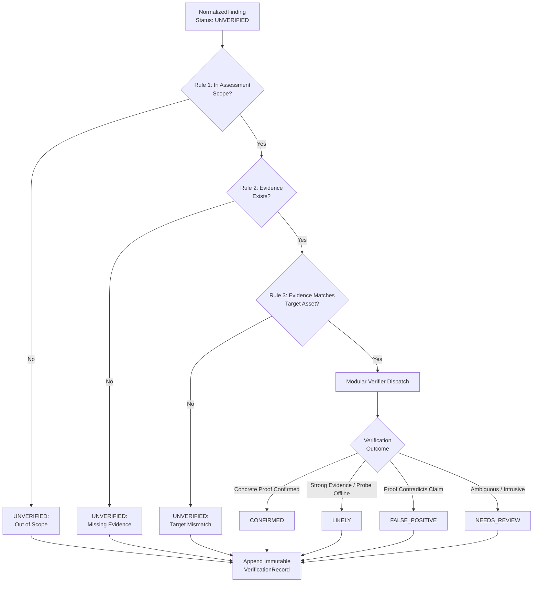

# AegisPT: Finding Verification Engine

This document details the architecture, evaluation rules, modular verification plugins, human review workflows, and immutable audit logging for the **AegisPT Finding Verification Engine** (`aegispt.security_engine.verification`).

---

## 1. Overview & Verification Philosophy

Automated vulnerability scanners produce hypotheses, not established facts. A finding should never be marked as `CONFIRMED` merely because:
- A scanner reported it with a high score.
- An AI reasoning module assigned high confidence.
- A vulnerability title matches a common CWE or CVE entry.
- A software version appears outdated without corroborating proof.

The **Verification Engine** implements a deterministic pipeline to evaluate whether candidate findings are substantiated by tangible, reproducible evidence.



---

## 2. Standard Verification Statuses

| Status | Meaning | Operational Consequence |
|---|---|---|
| `CONFIRMED` | Vulnerability presence is substantiated by unambiguous evidence or non-destructive live probe. | Finding is marked `verified=True`. Eligible for immediate remediation workflow. |
| `LIKELY` | Substantial evidence exists (e.g. static payload match), but live probe was unavailable. | Flagged for operator awareness; elevated priority over unverified items. |
| `FALSE_POSITIVE` | Evidence demonstrates defensive controls are active, or live probe disproves the alert. | Excluded from report findings to eliminate noise and save engineering time. |
| `UNVERIFIED` | Initial state. Also assigned if evidence is missing, corrupted, or out of scope. | Retained in findings inventory but marked unconfirmed. |
| `NEEDS_REVIEW` | Evidence is ambiguous, or confirmation requires intrusive active exploits. | Routed to human security analyst. Never artificially forced to `CONFIRMED` or `FALSE_POSITIVE`. |

---

## 3. The 7-Step Verification Pipeline

When [`VerificationEngine.verify_finding()`](file:///c:/Users/JASIF/OneDrive/Desktop/Idea/aegispt/security_engine/verification/engine.py) processes a finding:

1. **Scope Membership Check:** Verifies that the affected asset (`target.target_value` or `asset_id`) belongs to the active assessment engagement scope.
2. **Evidence Existence Check:** Verifies that non-empty `evidence` citations exist. Findings with zero citations are rejected as `UNVERIFIED`.
3. **Asset Correlation Check:** Verifies that the evidence metadata (`target_url`, `uri`) correlates with the finding's target asset.
4. **Structural Validity Check:** Confirms mandatory fields (title, severity, scanner ID) are populated.
5. **Vulnerability Type Matching:** Matches the finding's `cwe_id` or title against registered modular verification plugins.
6. **Safe Verification Execution:** The matching plugin evaluates the evidence using benign, non-destructive validation logic (e.g. live header checks or ground truth correlation).
7. **Immutable Audit Logging:** Creates a [`VerificationRecord`](file:///c:/Users/JASIF/OneDrive/Desktop/Idea/aegispt/security_engine/verification/models.py) recording finding ID, method, timestamps, evidence citations, previous status, new status, and reasoning.

---

## 4. Modular Verification Plugins

All plugins inherit from [`BaseVerifier`](file:///c:/Users/JASIF/OneDrive/Desktop/Idea/aegispt/security_engine/verification/base.py) and declare strict constraints:

### 1. `HeaderSecurityVerifier` (`verifier_header_security`)
- **Supported Weaknesses:** `CWE-693`, `CWE-1021`, `CWE-16` (Missing CSP, X-Frame-Options, X-Content-Type-Options).
- **Evaluation Logic:**
  - Queries target URL via live HTTP `GET`/`HEAD`.
  - If header is absent $\rightarrow$ `CONFIRMED`.
  - If header is present $\rightarrow$ `FALSE_POSITIVE`.
  - If live connection fails $\rightarrow$ `LIKELY` (if static snippet confirms absence) or `NEEDS_REVIEW`.

### 2. `PassiveReflectionVerifier` (`verifier_passive_reflection`)
- **Supported Weaknesses:** `CWE-79` (Reflected XSS).
- **Evaluation Logic:**
  - Inspects evidence snippet:
    - If unencoded script tags or event handlers (`<script>`, `onerror=`) are reflected in raw HTML $\rightarrow$ `CONFIRMED`.
    - If payload is safely HTML-encoded (`&lt;script&gt;`, `&quot;`) $\rightarrow$ `FALSE_POSITIVE`.
    - If ambiguous $\rightarrow$ `NEEDS_REVIEW`.

### 3. `LabGroundTruthVerifier` (`verifier_lab_ground_truth`)
- **Supported Weaknesses:** Testbed flaws across OWASP Juice Shop.
- **Evaluation Logic:**
  - Correlates findings against documented, verified vulnerabilities in the local lab (e.g. search XSS, login SQLi, missing CSP).
  - Matches $\rightarrow$ `CONFIRMED`.
  - Contradicts lab defensive controls $\rightarrow$ `FALSE_POSITIVE`.
  - Outside catalogue $\rightarrow$ `NEEDS_REVIEW`.

---

## 5. Audit Logging Architecture

Every verification action generates an immutable audit record:

```json
{
  "record_id": "7f8b9a1c2d3e4f5a6b7c8d9e0f1a2b3c",
  "finding_id": "finding-3a8e9f21b7c4d0a1",
  "verification_method": "verifier_header_security",
  "timestamp": "2026-10-24T21:00:00Z",
  "evidence_ids": ["ev-12345678"],
  "previous_status": "UNVERIFIED",
  "new_status": "CONFIRMED",
  "reason": "Live probe confirmed header 'content-security-policy' is genuinely missing from response headers.",
  "metadata": {
    "status_code": 200
  }
}
```

The engine retains original raw scanner artifacts intact. Audit logs provide full chain-of-custody transparency for regulatory and peer-review audits.

---

## 6. Known Limitations

1. **Non-Destructive Boundary:**
   - Active, potentially destabilizing validation (such as injecting blind SQL injection delays or triggering out-of-band DNS interactions) is prohibited by safety policy and routes to `NEEDS_REVIEW`.
2. **Context-Dependent XSS:**
   - Script reflection inside quoted JavaScript strings or JSON attributes may require dynamic browser DOM evaluation (e.g. Playwright) to confirm execution; the passive reflection verifier marks these as `NEEDS_REVIEW`.
