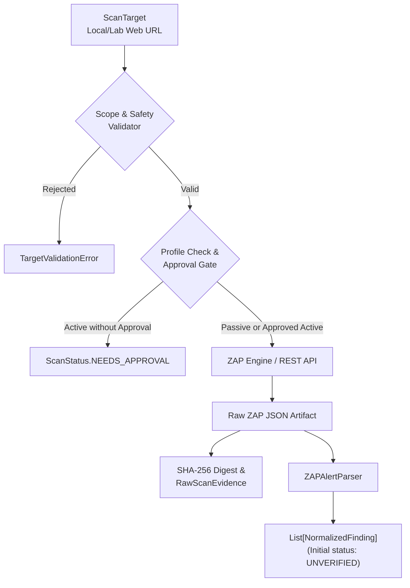

# AegisPT: OWASP ZAP Scanner Adapter

This document details the configuration, security controls, scan workflows, alert parsing, and operational guidelines for the **OWASP ZAP Scanner Adapter** (`aegispt.security_engine.integrations.zap`).

---

## 1. Overview & Architecture

The OWASP ZAP adapter enables dynamic web application security scanning against authorized local testbeds (such as OWASP Juice Shop). It supports two operational tiers:
1. **Passive Baseline Scanning:** Non-intrusive spidering and passive response analysis (e.g., missing security headers, sensitive cookies, information leakage) without active attack payloads.
2. **Controlled Active Scanning:** Parameter probing and vulnerability verification strictly restricted to local lab targets, subject to **mandatory human operator approval**.



---

## 2. ZAP Setup & Deployment

ZAP can be run locally via Docker (recommended) or as a native desktop installation:

### Option A: Running ZAP via Docker (Headless Daemon)
```powershell
docker run -u zap -p 127.0.0.1:8080:8080 -d --name aegispt-zap \
  ghcr.io/zaproxy/zaproxy:stable zap.sh -daemon \
  -host 127.0.0.1 -port 8080 \
  -config api.disablekey=true \
  -config api.addrs.addr.name=127.0.0.1 \
  -config api.addrs.addr.regex=false
```

### Option B: Local Desktop Installation
1. Download ZAP from [zaproxy.org/download/](https://www.zaproxy.org/download/).
2. Start ZAP with the API enabled on `127.0.0.1:8080`.
3. If an API key is enabled, export it into your environment:
   ```powershell
   $env:AEGISPT_ZAP_API_KEY="your-zap-api-key"
   ```

---

## 3. Automation Framework Configuration

The adapter supports both direct REST API communication and [OWASP ZAP Automation Framework](https://www.zaproxy.org/docs/automate/automation-framework/) job plans.

Sample Automation Framework baseline job (`zap-baseline-plan.yaml`):
```yaml
env:
  contexts:
    - name: "AegisPT-LocalLab"
      urls:
        - "http://127.0.0.1:3000"
      includePaths:
        - "http://127.0.0.1:3000.*"
jobs:
  - type: spider
    parameters:
      maxDepth: 3
      maxDuration: 2
  - type: passiveScan-wait
    parameters:
      maxDuration: 5
  - type: report
    parameters:
      template: traditional-json
      reportDir: artifacts/scans
      reportFile: zap_report.json
```

---

## 4. Scan Profiles & Safety Controls

| Profile ID | Mode | Impact | Human Approval | Purpose |
|---|---|---|---|---|
| `zap_passive_baseline` | Passive | `LOW` | **No** | Spiders target, inspects HTTP traffic, extracts passive alerts without sending attack vectors. |
| `zap_active_baseline` | Active | `MEDIUM` | **Yes (Required)** | Actively fuzzes parameters with bounded request rate (`max_rate_limit: 20 req/s`). |

### Approval & Rate Limiting Guardrails:
1. **Mandatory Approval Gating:**
   - Any scan request using `zap_active_baseline` without `"human_approval_granted": True` in `request.options` is halted and returns `ScanStatus.NEEDS_APPROVAL`.
2. **Local Scope Verification:**
   - Targets are verified via `target.is_local_or_private()`.
   - Public internet domains and external IPs are rejected prior to execution.
3. **Cancellation Mechanism:**
   - The adapter exposes `scanner.cancel_scan(request_id)` using threaded cancellation events to terminate long-running crawls or active probes.

---

## 5. Alert Parsing & Normalization

The [`ZAPAlertParser`](file:///c:/Users/JASIF/OneDrive/Desktop/Idea/aegispt/security_engine/integrations/zap/parser.py) ingests both standard REST API alert payloads and Automation Framework JSON reports.

### Field Mappings:
- **Alert Name:** Extracted from `name` / `alert`.
- **Severity Mapping:**
  - `High` / `3` $\rightarrow$ `Severity.HIGH`
  - `Medium` / `2` $\rightarrow$ `Severity.MEDIUM`
  - `Low` / `1` $\rightarrow$ `Severity.LOW`
  - `Informational` / `0` $\rightarrow$ `Severity.INFO`
- **CWE:** Extracted from `cweid` / `cwe_id`.
- **Evidence:** Parameter name, attack payload, and snippet preserved in [`EvidenceReference`](file:///c:/Users/JASIF/OneDrive/Desktop/Idea/aegispt/security_engine/schemas/finding.py).

### Initial Verification Status:
> [!IMPORTANT]
> **Zero Unverified Confidence:** ZAP alerts are initial automated candidates. In accordance with platform design, all ZAP findings are generated with `verified=False` (`UNVERIFIED`). Findings are only elevated to verified status after confirmation by the dedicated verification subsystem.

---

## 6. Known Limitations

1. **Daemon Prerequisite:**
   - ZAP must be running in daemon mode or inside Docker before initiating live API scans. If unreachable, the adapter traps `requests.ConnectionError` and returns `ScanStatus.FAILED` with error code `ZAP_UNAVAILABLE`.
2. **Single-Page Application (SPA) Crawling:**
   - Basic spidering can miss client-side routes in heavy JavaScript SPAs (like Juice Shop's Angular UI). For full SPA coverage, the Ajax Spider (requiring headless Chrome/Firefox) must be configured in ZAP.
3. **Execution Duration:**
   - Full active scans across modern web applications can take several minutes. Strict per-profile timeouts (`timeout_seconds`) and bounded request limits prevent testbed starvation.
