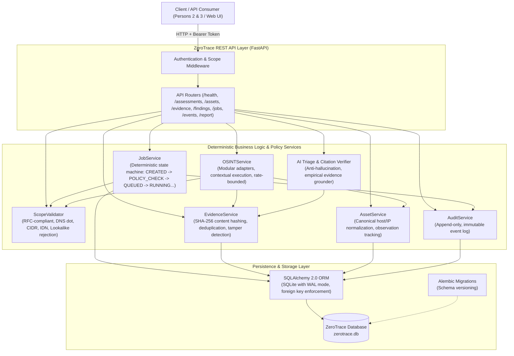
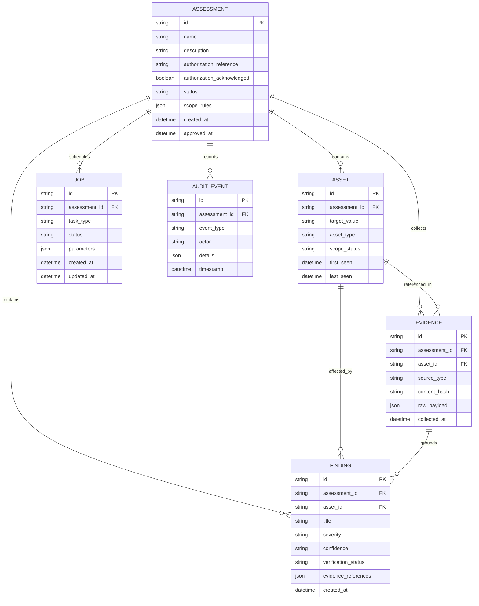

# ZeroTrace Architecture Specification

ZeroTrace is a secure, deterministic security assessment and vulnerability management platform designed for reproducible reconnaissance, scoped scanning, evidence-backed finding correlation, and audit logging.

---

## 1. High-Level Architecture Overview

---

## 2. Component Breakdown

### 2.1 API Layer (`backend/app/main.py`, `backend/app/api/`)
- **FastAPI Application**: Lightweight, asynchronous web framework exposing REST endpoints under `/` and `/api`.
- **Security & Auth**: Token-based authentication using HTTP Bearer (`Authorization: Bearer <token>`). Rejects invalid or missing credentials on protected routes with `401 Unauthorized`.
- **Error Handling**: Deterministic JSON error envelopes with structured error codes (`UNAUTHORIZED`, `SCOPE_DENIED`, `INVALID_STATE_TRANSITION`, `RESOURCE_NOT_FOUND`).

### 2.2 Shared Contracts Layer (`aegis_common/`)
- Single canonical importable package containing Pydantic v2 schemas for all shared entities: `Assessment`, `Asset`, `Evidence`, `Finding`, `Job`, `AuditEvent`.
- Enums (`aegis_common.enums`): Strict typing for statuses, severities, confidence tiers, and source types.
- JSON Schema Versioning: Versioned JSON schemas generated in `schemas/v1/` to guarantee cross-module contract freeze.

### 2.3 Deterministic Policy & Scope Validator (`backend/app/services/scope_validator.py`)
- Independent of AI decisions: purely algorithmic validation.
- Normalization:
  - DNS hostnames: lowercase conversion, IDN Punycode decoding, trailing dot removal.
  - IP addresses & subnets: IPv4/IPv6 canonicalization, CIDR containment checking.
  - URLs: canonical scheme, host, port, and path parsing.
- Lookalike & Subdomain Protection: Strict domain suffix matching (`*.example.test`), preventing subdomain lookalike escapes (e.g. `example.test.attacker.com` is denied).
- Default Deny: Denies any target that is not explicitly in `included_targets` or matches `excluded_targets`.

### 2.4 Evidence & Asset Services (`backend/app/services/asset_service.py`, `backend/app/services/evidence_service.py`)
- **Content Hashing**: SHA-256 cryptographic digest computed over canonical JSON or raw observation bytes.
- **Idempotent Deduplication**: Duplicate observations for the same asset and payload hash are updated without duplicating evidence rows.
- **Strict Evidence Clamping**: A `Finding` cannot be registered as `CONFIRMED` unless backed by verifiable evidence records in the database. Cross-assessment evidence references are rejected.

### 2.5 Job Lifecycle Engine (`backend/app/services/job_service.py`)
- Finite state machine with explicit allowed transitions:
  - `CREATED -> POLICY_CHECK -> QUEUED -> RUNNING -> REVIEW -> COMPLETED`
  - Cancellation branch: `CREATED / QUEUED / RUNNING / REVIEW -> CANCELLED`
  - Error branch: `* -> FAILED`
- Unlisted transitions raise `InvalidStateTransitionError` without modifying database state.
- Supports timeout enforcement and immediate cancellation propagation.

### 2.6 Modular Passive OSINT Framework (`backend/app/services/osint/`)
- Plugin-like interface via `OSINTAdapter` protocol.
- `MockOSINTAdapter`: Deterministic, offline synthetic adapter used in automated tests and air-gapped CI/CD.
- Bounded execution with strict timeouts and rate limits to respect host resources ("potato-PC" friendly).

### 2.7 Audit Engine (`backend/app/services/audit_service.py`)
- Append-only immutable log for all security-relevant operations: assessment creation, approvals, scope checks, job state transitions, cancellations, and findings ingestion.
- Guaranteed audit trail for forensic compliance.

### 2.8 AI Triage & Citation Verifier (`modules/ai/`, `backend/app/api/ai_endpoints.py`)
- Evaluates findings strictly against provided empirical evidence.
- Runtime citation validation (`validate_citations`): Rejects responses containing invented evidence identifiers and falls back to deterministic rule-based analysis.

---

## 3. Database Schema Entity-Relationship Diagram

